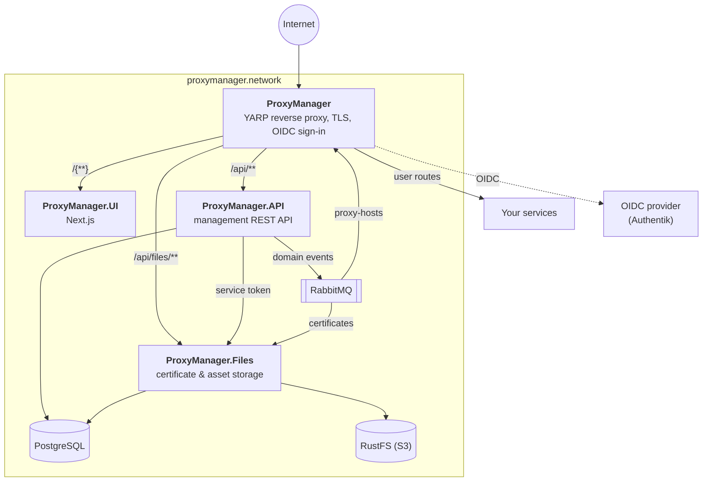

# YARP Proxy Manager (YPM)

[](https://github.com/jschlachter/yarp-proxy-manager/actions/workflows/build-proxymanager.yml)
[](LICENSE)

YARP Proxy Manager (YPM) is a modern, .NET-native reverse proxy management platform built to make secure host publishing straightforward. It gives you a clean way to route traffic, terminate SSL, and manage proxy behavior without wrestling with manual web server configuration.

Much of the inspiration comes from the great project [NGINX Proxy Manager](https://github.com/NginxProxyManager/nginx-proxy-manager).

Built on [YARP](https://learn.microsoft.com/en-us/aspnet/core/fundamentals/servers/yarp/getting-started), YPM combines familiar proxy capabilities with an architecture that feels natural to .NET teams: composable, extensible, and portable across development and production environments.

> [!WARNING]
> YPM is in **alpha** (`1.0.0-alpha`). Configuration, APIs and the database schema may still change between versions without a migration path.

## Contents

- [Features](#features)
- [Architecture](#architecture)
- [Getting started](#getting-started)
- [Configuration](#configuration)
- [TLS certificates](#tls-certificates)
- [Deployment (Podman Quadlet)](#deployment-podman-quadlet)
- [Testing](#testing)
- [Repository layout](#repository-layout)
- [Contributing](#contributing)
- [Acknowledgements](#acknowledgements)
- [License](#license)

## Features

- **Proxy hosts from a web UI.** Create, edit and disable routes; changes are pushed to the proxy over RabbitMQ and hot-reloaded into YARP with no restart.
- **Automatic HTTPS.** Per-host Let's Encrypt certificates (ACME HTTP-01) via [LettuceEncrypt](https://github.com/ArchonSystemsInc/LettuceEncrypt), or upload your own PFX/PEM certificates, wildcards included. Certificates are selected per request by SNI.
- **Health checks.** Optional YARP active and passive health checks per proxy host, with live health badges in the UI.
- **Single sign-on.** Browser users sign in through an OpenID Connect provider (developed against [Authentik](https://goauthentik.io/)); access tokens are refreshed silently, and group claims drive admin rights in the UI.
- **Audit log.** Every create, update and delete of a proxy host is recorded as an audit entry, with the user who made it.
- **Isolated management surface.** The UI and management API only answer on configured management host names; every other domain belongs to your proxied services.
- **.NET all the way down.** ASP.NET Core, YARP, EF Core and Wolverine: easy for .NET developers to read, extend and debug.
- **Container-first deployment.** Ships as OCI images with rootless Podman Quadlet units managed by systemd.

## Architecture



| Component | Role |
|---|---|
| **ProxyManager** (`src/ProxyManager`) | The reverse proxy itself. Terminates TLS, authenticates browser users with OIDC (cookie session), serves the UI and management API on the management host, and routes every other domain to its configured backend. Routes come from config (system routes) and the database (user routes). |
| **ProxyManager.API** (`src/ProxyManager.API`) | Management REST API (`/api/proxyhosts`, `/api/certificates`). JWT bearer auth. Publishes domain events to RabbitMQ. |
| **ProxyManager.Files** (`src/ProxyManager.Files`) | Stores uploaded certificate files in S3-compatible object storage (RustFS), which is never exposed to browsers. |
| **ProxyManager.UI** (`src/ProxyManager.UI`) | Next.js App Router frontend, served behind the proxy. |
| **ProxyManager.Core / .Infrastructure** | Domain model (DDD aggregates, messages) and EF Core / PostgreSQL data access. |

## Getting started

### Prerequisites

- [.NET 11 SDK](https://dotnet.microsoft.com/download)
- [Node.js 24](https://nodejs.org/) for the UI
- [Podman](https://podman.io/) (or Docker) to run PostgreSQL, RabbitMQ and RustFS, and for the integration tests
- An **OpenID Connect provider** with a client for YPM. The project is developed against Authentik; the provider must issue a `groups` claim.
- A **DNS name** for the management UI (default `proxy-manager.west94.io`; change it with `Management:Hosts`). The UI is only served on that name; `localhost` or an IP falls through to the 404 page.

### Run from source

1. **Start the backing services.** The simplest route is the Quadlet stack below, which publishes PostgreSQL (`5432`), RabbitMQ (`5672`, management UI `15672`) and RustFS (`9000`, console `9001`) on the host. Point the `Database`, `RabbitMQ` and `ObjectStorage` settings in each service's `appsettings.Development.json` (or [user secrets](https://learn.microsoft.com/aspnet/core/security/app-secrets)) at them.

2. **Provide secrets** as environment variables or user secrets, never in committed files:

   | Setting | Used by |
   |---|---|
   | `POSTGRES_PASSWORD` (interpolated into `{{POSTGRES_PASSWORD}}` in connection strings) | Proxy, API, Files |
   | `Authentication__ClientId`, `Authentication__ClientSecret` | Proxy |
   | `Authentication__Audience` | API, Files |
   | `FILES_SERVICE_TOKEN` / `ServiceToken__SharedSecret` (same value) | API & Proxy / Files |
   | `ObjectStorage__AccessKey`, `ObjectStorage__SecretKey` | Files |

3. **Run the services** (or use the **"Launch It All"** compound configuration in VS Code):

   ```bash
   dotnet run --project src/ProxyManager/ProxyManager.csproj              # proxy      https://localhost:7129
   dotnet run --project src/ProxyManager.API/ProxyManager.API.csproj     # API        https://localhost:5001
   dotnet run --project src/ProxyManager.Files/ProxyManager.Files.csproj # files      https://localhost:5002

   cd src/ProxyManager.UI && npm ci && npm run dev                        # UI         http://localhost:3000
   ```

   `proxysettings.Development.json` expects the API on `:5001`, Files on `:5002` and the UI on `:3000`.

4. **Local TLS.** Generate a self-signed certificate for local development:

   ```bash
   cd scripts/ssl && ./generate-pfx-cert.sh -o localhost.pfx
   ```

## Configuration

Each .NET service uses standard ASP.NET Core configuration (`appsettings.json`, `appsettings.{Environment}.json`, environment variables with `__` as the separator). Notable settings:

| Key | Service | Description |
|---|---|---|
| `Management:Hosts` | Proxy | **Required.** Host name(s) the UI, management API and sign-in endpoints answer on. Startup fails if empty. |
| `Authentication:Authority` / `ClientId` / `ClientSecret` / `Audience` | All | OIDC provider and client settings. |
| `Database:ConnectionString` | Proxy, API, Files | PostgreSQL connection string; supports `{{Token}}` placeholders resolved from configuration. Migrations run automatically at startup. |
| `RabbitMQ:Host` / `UserName` / `Password` / `Enabled` | Proxy, API, Files | Message broker. `Enabled=false` disables messaging (handy for single-service runs and tests). |
| `FilesService:BaseUrl` / `ServiceToken` | Proxy, API | Where to reach the Files service, and the shared service token. |
| `ObjectStorage:*` | Files | S3 endpoint, bucket and credentials (RustFS). |
| `LettuceEncrypt:EmailAddress` / `UseStagingServer` | Proxy | ACME account contact; set `UseStagingServer=false` for browser-trusted certificates. |
| `FallbackCertificate:Path` / `Password` | Proxy | Certificate served when no other matches; see below. |
| `AUTHENTIK_ACCOUNT_URL`, `ADMIN_GROUP_CLAIM` | UI | Self-service account page link, and the group whose members get admin rights (default `proxy-admins`). |

System routes (UI, API, Files) live in `src/ProxyManager/proxysettings.{Environment}.json`; user routes live in the database and are managed from the UI.

## TLS certificates

The proxy picks a certificate for every TLS handshake by SNI, in this order:

1. A certificate stored in YPM (uploaded through the UI/API, or previously issued by Let's Encrypt) whose subject alternative names match the requested host, wildcards included.
2. A Let's Encrypt certificate issued on demand for proxy hosts set to the *Let's Encrypt* TLS mode. HTTP-01 validation requires port 80 to be reachable from the internet.
3. The **fallback certificate**, loaded at startup from `FallbackCertificate:Path` (default: `certs/<first management host>.pfx`, relative to the app directory; `/app/certs/` in the container).

The fallback matters on a fresh install. The management UI is only reachable over HTTPS on the management host, so before any certificate has been uploaded it is the only certificate the proxy can serve for it. **Put a PFX for your management host in `~/proxymanager/certs/` before first start**; without one, handshakes for the management host fail and the UI is unreachable.

> [!NOTE]
> The default production configuration uses the Let's Encrypt **staging** server (`LettuceEncrypt:UseStagingServer=true`), whose certificates browsers don't trust. Set it to `false` once you have verified issuance works.

## Deployment (Podman Quadlet)

YPM is deployed as rootless Podman containers managed by systemd through [Quadlet](https://docs.podman.io/en/latest/markdown/podman-systemd.unit.5.html). Each service has its own folder under `systemd/` with a `deploy.sh` and its unit files. All containers join `proxymanager.network` and are grouped by `proxymanager.target`, so the whole stack is controlled as one unit:

```bash
systemctl --user start proxymanager.target
systemctl --user restart proxymanager.target
systemctl --user stop proxymanager.target 'proxymanager*.service'
```

Only the proxy's ports `80` and `8443` are meant to be public. PostgreSQL, RabbitMQ and RustFS also publish their ports for local development; see `systemd/TODO.md`.

### 1. Build the images

```bash
./scripts/build-images.sh all          # proxy | api | files | ui | all
```

The default tag is the one pinned by the units' `Image=` lines, so a build always produces what the units run.

### 2. Site settings

```bash
cp systemd/proxymanager.env.example systemd/proxymanager.env   # gitignored
```

Fill in the non-secret, site-specific values (OIDC client ID and audience, ACME email, management host, UI settings). **Never put secrets in this file.** Secrets are Podman secrets, which the deploy scripts create: database password, RabbitMQ credentials, RustFS keys and the Files service token are generated, and the OIDC client secret is taken from `OIDC_CLIENT_SECRET` or prompted for.

### 3. Deploy

To a remote host over SSH (copies the images too, since there is no registry):

```bash
./scripts/deploy-remote.sh user@host            # --dry-run to preview, --only=api,ui, --no-restart
```

To the local Podman Desktop VM:

```bash
./scripts/deploy-vm.sh --restart
```

Then copy your management host's PFX to `~/proxymanager/certs/` on the host (see [TLS certificates](#tls-certificates)).

Host requirements: Podman, a systemd user session with lingering enabled (`loginctl enable-linger $USER`) so the stack survives logout, and `net.ipv4.ip_unprivileged_port_start=80` so the rootless proxy can bind port 80.

## Testing

```bash
dotnet test ProxyManager.slnx                                   # all .NET tests
dotnet test ProxyManager.slnx -- --filter-trait "Category=Unit" # unit tests only (what CI runs)

cd src/ProxyManager.UI
npm test                # Jest
npm run test:e2e        # Playwright
```

The .NET tests use xunit v3 on Microsoft.Testing.Platform. Tests tagged `Category=Integration` start a real PostgreSQL with [Testcontainers](https://dotnet.testcontainers.org/), so they need a running container engine.

## Repository layout

```
src/
  ProxyManager/                 reverse proxy (YARP), TLS, OIDC sign-in
  ProxyManager.API/             management REST API
  ProxyManager.Files/           file/certificate storage service
  ProxyManager.Core/            domain model, messages, DTOs
  ProxyManager.Infrastructure/  EF Core data access
  ProxyManager.UI/              Next.js frontend
tests/                          .NET unit and integration tests
systemd/                        Podman Quadlet units and per-service deploy scripts
scripts/                        image build, deployment and SSL helper scripts
adrs/                           architecture decision records and their implementation plans
docs/                           design notes
```

## Contributing

Issues and pull requests are welcome. For anything beyond a small fix, please open an issue first to discuss the change.

- Build and test locally (`dotnet build ProxyManager.slnx`, unit tests, and `npm test` for UI changes) before opening a PR; CI runs the .NET build and unit tests on every pull request.
- Tag new tests with `[Trait("Category", "Unit")]` or `[Trait("Category", "Integration")]`.
- C# conventions: file-scoped namespaces, primary constructors, the Options pattern instead of injecting `IConfiguration`, and `TypedResults` in endpoints. See `.claude/rules/` for the full guidelines.
- For a change that involves a real design decision, add an ADR under `adrs/`.

## Acknowledgements

- [NGINX Proxy Manager](https://github.com/NginxProxyManager/nginx-proxy-manager), the inspiration for this project
- [YARP](https://github.com/dotnet/yarp), [LettuceEncrypt](https://github.com/ArchonSystemsInc/LettuceEncrypt), [Wolverine](https://wolverinefx.net/), [RustFS](https://rustfs.com/) and [Authentik](https://goauthentik.io/)

## License

YPM is licensed under the [MIT License](LICENSE).
